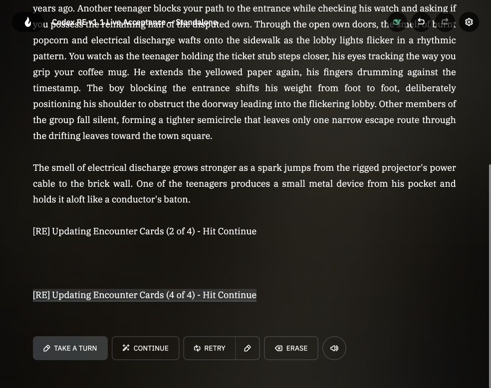
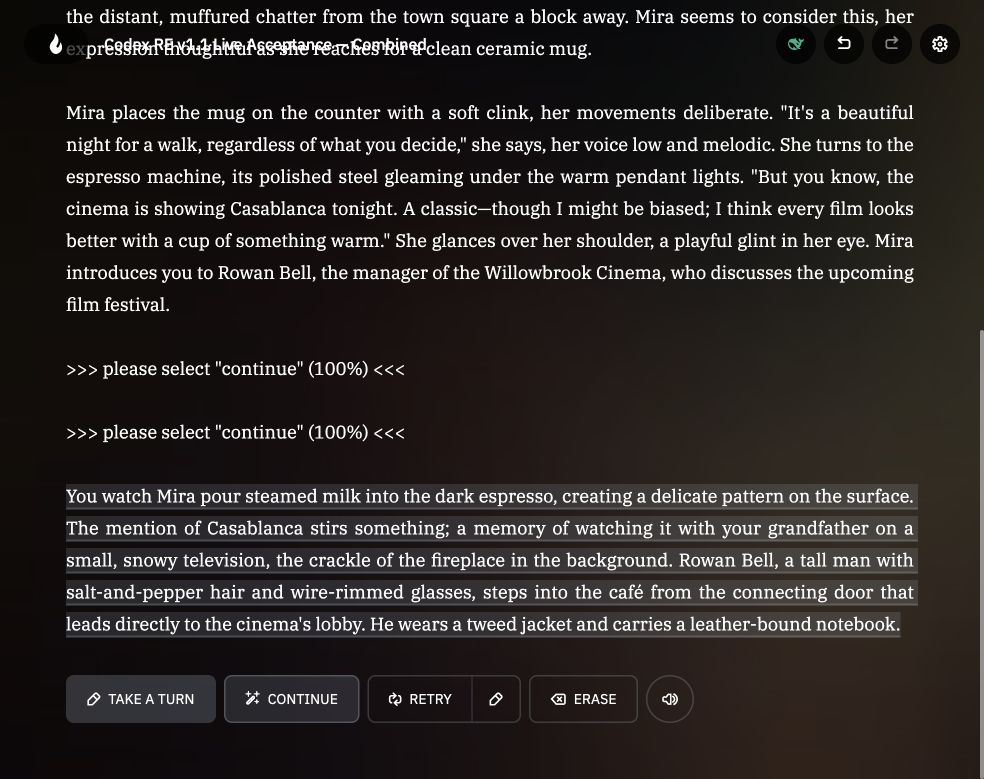

# Codex v1.1 Test Report — October 11, 2026

Automated regressions passed, but v1.1 is not ready for release: three defects remain, and some live acceptance checks could not be verified.

Only `develop/v1.1` was accessed. Production code, repository tests, and public releases were unchanged by testing. Testing did not commit or publish changes. The maintainer subsequently requested adding and committing this report and its evidence.

## Environment and automated results

- Branch: `develop/v1.1`
- Tested HEAD: `e74b3f04c885b4800214511a243a93338ac7e217`
- Checkout: clean before and after testing, before adding this report
- Node: `v24.19.0`
- Executed: branch/SHA/status checks, `node docs/tests/smoke.cjs`, syntax checks, and supplemental probes outside the repository
- Built-in suite: **273/273 PASS**, no failing assertion or stack trace
- Six production wrappers, both libraries, and standalone/combined source parity: **PASS**

## Deterministic coverage

| Area | Result |
| --- | --- |
| Config initialization and defaults | PASS |
| Manual RAND registration and content preservation | PASS |
| Duplicate key reassignment | PASS |
| Act categories | PASS |
| First Encounter Turn scheduling | PASS |
| Invalid-card exclusion and cancellation | PASS |
| Boolean mode normalization, OR behavior, Notes preservation | PASS |
| Generation difficulty/theme snapshots | FAIL on same-action Retry |
| Generation protocol validation | FAIL on malformed sentences |
| Cumulative progress, toggle reset, Context status cleanup | PASS |
| Lifecycle and compatibility | PASS offline; FAIL live Retry accounting |

The additional failures expose gaps in the built-in harness; they are not failing assertions from the 273-check suite.

## Live acceptance

Tests used fresh private adventures and actual model output. No simulated partial response was used to establish live generation coverage.

| Group | Result and evidence |
| --- | --- |
| A — Registration | PASS, Shimmer Pro. Duplicate courier became RAND05; custom title/Entry survived; missing Notes defaulted to mode false; changing Act moved its category to Act 2. |
| B — Placeholders/scheduling | PASS observed behavior; remaining subchecks NOT RUN. Valid RAND01 injected at RE turn 3; other placeholders were excluded. Blanking the Active Entry cancelled it without an Outcome. The transient invalid-start warning was not captured, and a valid pool before turn 3 was not tested. |
| C — Generation | PASS generation/resumption; prompt inspection BLOCKED. Shimmer Pro produced two unparseable prose attempts. DeepSeek then genuinely populated 2/4 and the remaining 2/4. Receipts correctly showed cumulative 2/4 then 4/4; Entries were complete sentences; the toggle reset to false and storytelling resumed. Full live Context text was unavailable. |
| D — Mode/Retry | FAIL Retry accounting; prompt inspection BLOCKED. All four boolean combinations ran with Shimmer Pro. Forced encounters were only partially introduced; immediate narrative compliance was inconsistent. RAND04 retained exactly one true field through activation and resolution. |
| E — Combined scripts | PASS observed integration. DeepSeek updated Mira's Inner Self brain and Auto-Cards generated Mira and Willowbrook Cinema cards. Logs confirmed RE stayed at turn 3 during Auto-Cards ownership, then resumed at turn 4. Simultaneous Inner Self/Auto-Cards priority contention was NOT RUN. |

The scripting diagnostics were available, but **View context returned an empty panel**. Exact live prompt strength, generation wording, and absence of status text from later model Context remain unverified. Offline prompt tests do not substitute for these checks.

Group A/B used First Encounter Turn 30 during maintenance; B then changed it to 3 before the scheduled opportunity. Group C used Hard difficulty, theme `night at the movies`, placeholder population enabled, and debug logging enabled. Group D used four valid authored encounters, First Encounter Turn 30, and the four global/card mode combinations. Group E used the maintained combined scripts, debug logging, Mira as an Inner Self NPC with 100% thought chance, and temporarily shortened Auto-Cards creation cooldown/title age to trigger ownership.

### Test adventures

- A: https://play.aidungeon.com/adventure/MfEk-rFBdWd2/codex-re-v11-live-acceptance-standalone/play
- B: https://play.aidungeon.com/adventure/3rS_0jUnfJD4/codex-re-v11-live-acceptance-standalone/play
- C: https://play.aidungeon.com/adventure/EqUPLKFO2y6n/codex-re-v11-live-acceptance-standalone/play
- D: https://play.aidungeon.com/adventure/FrcUiwzEBald/codex-re-v11-live-acceptance-standalone/play
- E: https://play.aidungeon.com/adventure/a9RfDHeDH60C/codex-re-v11-live-acceptance-combined/play

These are private test fixtures; account access is required.

## Defects and proposed fixes

### P2 — Live Retry consumes an encounter turn

Activate an encounter, generate its first response, then click Retry without taking another turn. Reproduced for RAND02 and RAND03: the timer changed **18 → 17**, and RE logged a new turn. Expected: unchanged turn/timer and the original introduction strength.

Investigate `detectTurnAdvance()` in [Library.js](../../Library.js), starting at line 1538 of the tested SHA. It treats history-length or action-count growth as advancement. This is a suspected cause, not a verified platform-counter diagnosis. Capture the platform counters and distinguish Retry from a new story turn.

Evidence: [before Retry](evidence/D-before-retry3.txt), [after Retry](evidence/D-after-retry3.txt).

### P2 — Same-action generation Retry loses the batch settings

Start a Hard batch themed `night at the movies`, then invoke Context again while its phase remains `generating`. The stored snapshot remains Hard/theme, but the retry prompt uses Easy and omits the theme. Ordinary queued batch retries preserve settings.

The generating-phase branch at `Library.js:2717` calls `buildDedicatedPlaceholderPopulationContext` without the request argument. Pass the existing batch snapshot and add this specific Retry regression case.

### P2 — Malformed generated Entries count as completed

Supplemental probes accepted `A visitor carrying.` as complete, preserved two sentences when the second began lowercase, and truncated an oversized sentence mid-word at 1,600 characters. A missing Title was also accepted.

Tighten `enforceSingleSentence()` and `parseDedicatedPlaceholderPopulation()` at `Library.js:2254` and `Library.js:2278`: reject incomplete records, handle sentence boundaries consistently, and avoid saving mid-sentence truncations. Leave rejected cards queued for retry.

The missing final END marker is intentionally tolerated by the current built-in suite; it is not classified as a separate defect here. The three-card supplemental batch correctly reported 3/3, preserved an authored card, and retained the first automatic opportunity after population.

Evidence for both offline generation findings: [supplemental reproducer](evidence/re-v11-audit.cjs). It was run outside the repository during testing and is not part of the regression suite. Its checkout path now resolves relative to this evidence directory; run it from the repository root with `node docs/test-reports/evidence/re-v11-audit.cjs`.

### P3 — Excessive spacing between consecutive receipts

Each receipt adds two newline characters on both ends, causing stacked spacing. The maintainer requested **one blank line above/below the group and one between receipts**. This is a presentation change to the current documented requirement, not a failure of the current exact-string assertion.

Relevant code: `Library.js:78` and the corresponding embedded implementation in `RE-InnerSelf-Merge/Library.js:8926`. Preserve readable outer spacing while avoiding stacked separators between consecutive receipts; coordinate any future change with documentation and regression expectations.

## Evidence and release readiness

- [Standalone Input/Context/Output diagnostics](evidence/modifier-logs.txt)
- [Combined Input/Context/Output diagnostics](evidence/E-modifier-logs.txt)
- [Resolved RAND04 Notes and Outcome](evidence/D-resolved-card4.txt)

**Automated regressions passed; live acceptance remains pending.** Address the defects and verify blocked prompt checks and the unrun subchecks before approving public release. No fixes or changes were published.

